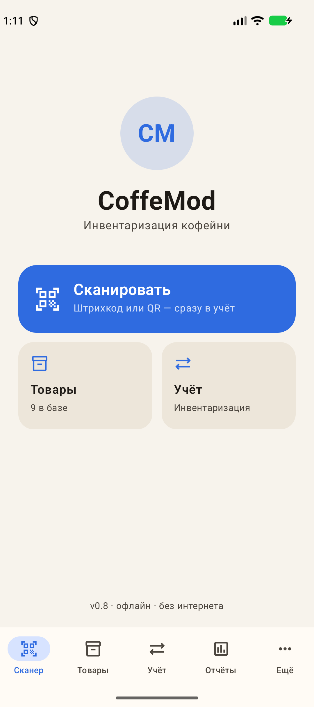
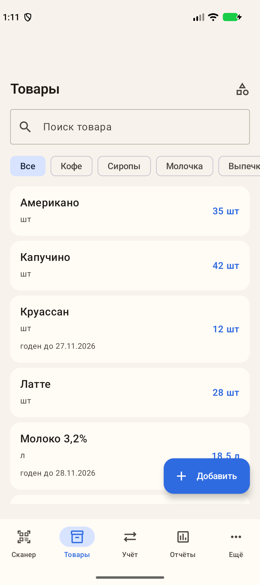
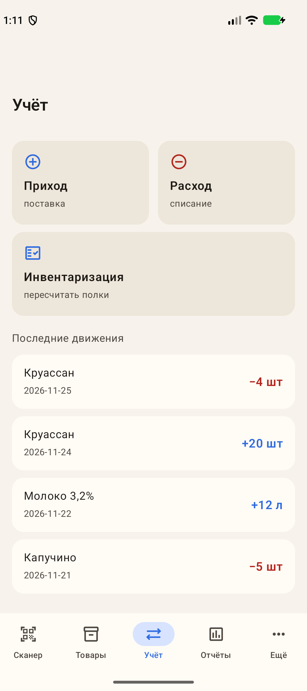

# CoffeMod

[](https://github.com/Gefest100500/Coffeemod/actions/workflows/build.yml)
[](https://kotlinlang.org/)
[](https://developer.android.com/jetpack/compose)
[](https://developer.android.com/media/camera/camerax)
[](https://developer.android.com)
[](LICENSE)
[](https://github.com/Gefest100500/Coffeemod/releases/latest)


Инвентаризация кофейни: товары, сканирование штрихкодов, приход/расход, пересчёт, этикетки и отчёты.

Приложение полностью офлайн: данные лежат в SQLite на устройстве, интернет не требуется.

<p align="center">
  
  
  
</p>

> На скриншотах — демонстрационные данные. **Скачать APK:** [последний релиз](https://github.com/Gefest100500/Coffeemod/releases/latest).

## Возможности

- **Товары** — группы, единицы измерения (шт/кг/г/л/мл/уп), минимальный остаток, срок годности, несколько штрихкодов на товар.
- **Сканер** — CameraX + ML Kit (офлайн): EAN-13/8, Code 128, Code 39, QR, UPC-A/E, ITF. Неизвестный код сразу предлагает создать товар.
- **Учёт** — приход и расход отдельными экранами, движения с датой и комментарием.
- **Инвентаризация** — сессия с черновиком, сканирование в процессе, сверка «учёт/факт», проведение с обновлением остатков.
- **Этикетки A4** — PDF с QR-кодами, для товаров без штрихкода создаётся внутренний код `INT-<id>`.
- **Отчёты** — история инвентаризаций с расхождениями, экспорт CSV, книга Excel (три листа), отправка через «Поделиться» (почта, MAX, Telegram).
- **Импорт продаж** — CSV вида `дата; товар или штрихкод; количество` → списание в расход.

## Сборка

Требуется JDK 17+ и Android SDK (compileSdk 37).

```bash
./gradlew assembleDebug     # отладочный APK
./gradlew assembleRelease   # подписанный релиз
```

APK: `app/build/outputs/apk/release/app-release.apk`.

## Подпись

Релиз подписывается ключом `keystore/coffemod-release.jks` (алиас `kashpendra`).
Ключ и файл с паролем **не хранятся в репозитории** — держите их отдельно и делайте резервную копию:
без этого ключа обновления поверх установленной версии невозможны.

## Структура

```
app/src/main/java/com/coffemod/
  data/     SQLite-схема, модели, репозиторий
  ui/       экраны: products, groups, scanner, account, reports
  util/     PDF-этикетки, XLSX, CSV, импорт продаж
  theme/    палитра Material 3
design/     исходник иконки и скрипт генерации
```

## Стек

Kotlin, Jetpack Compose (Material 3), CameraX, ML Kit, ZXing, SQLite (без ORM), minSdk 26.
## Нужен похожий инструмент?

Делаю приложения для инвентаризации и автоматизацию отчётности под конкретный процесс.
Открыт к проектам: Telegram [@Alex5063](https://t.me/Alex5063) · почта Idia94@mail.ru